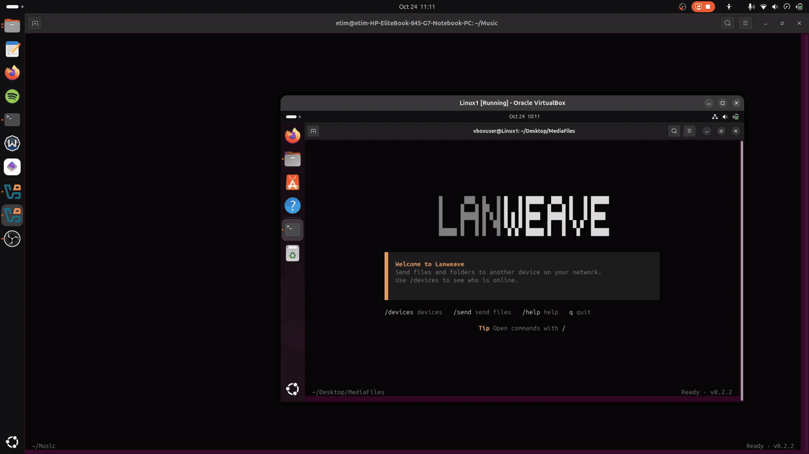

# Lanweave

<!-- SPDX-FileCopyrightText: 2026 Unyime Etim -->
<!-- SPDX-License-Identifier: Apache-2.0 -->

**Send files and folders directly to another computer on your local network.**

Lanweave is a terminal UI for local file transfer. Run it on two computers on the same network, pair them with a one-time code, and send files in either direction. The pairing and every transfer require explicit approval. No accounts, cloud service, or background daemon.

[](https://github.com/etim66/lanweave/actions/workflows/ci.yml)
[](https://github.com/etim66/lanweave/releases/latest)
[](LICENCE)

## Demo



*Pairing two computers and sending files. The demo runs at 2.5× speed. [Watch the MP4](docs/demo/lanweave-demo.mp4) for the higher-resolution version.*

## What It Does

- **Direct over your LAN** — devices talk to each other; there is no cloud relay or account.
- **Encrypted connection** — traffic is encrypted, and a one-time code authorizes the session.
- **Explicit approval** — pairing and every transfer are approved separately.
- **Files and folders** — folders are compressed into a single zip archive.
- **Ephemeral sessions** — closing the session removes authorization; there is no trusted-device list.

> [!WARNING]
> Lanweave is a work in progress and has not been security audited. Do not use it for sensitive files yet.

## Install

Lanweave runs on Linux (x86_64 and arm64) and Windows (x64). Both computers must be on the same local network. macOS builds are not available yet.

**Linux**

```sh
curl --proto '=https' --tlsv1.2 -LsSf \
  https://github.com/etim66/lanweave/releases/latest/download/lanweave-installer.sh | sh
```

**Windows (PowerShell)**

```powershell
powershell -c "irm https://github.com/etim66/lanweave/releases/latest/download/lanweave-installer.ps1 | iex"
```

The installer places `lanweave` in `~/.lanweave/bin` and adds that directory to `PATH` when needed. You can also download a build from [GitHub Releases](https://github.com/etim66/lanweave/releases/latest).

Run `/update` inside the app to check for a newer version. See [Updates](docs/UPDATES.md) for eligibility and the trust model.

## Quick Start

1. Run `lanweave` on both computers.
2. On one computer, type `/devices` and select the other computer.
3. On the other computer, accept the pairing request, then enter the eight-digit code it shows into the first computer.
4. Type `/send`, paste one or more file or folder paths, and press Enter. The other computer reviews the list and accepts.

Press `/` to see all commands and `q` to quit. See the [usage guide](docs/USAGE.md) for the full command reference.

## Status

Discovery, pairing, encrypted transport, and transfers in either direction work today. Hardening, macOS packaging, and security review are still in progress. See the [implementation roadmap](docs/IMPLEMENTATION_ROADMAP.md) and [security status](docs/SECURITY.md).

## Documentation

- [Usage guide](docs/USAGE.md) — commands, keyboard shortcuts, and the session flow
- [Architecture](docs/ARCHITECTURE.md) — module boundaries, events, and task ownership
- [Security](docs/SECURITY.md) — trust boundary, controls, and remaining risks
- [Contributing](CONTRIBUTING.md) — local setup, tests, and module ownership
- [All documentation](docs/README.md) — protocol, transport, discovery, threat model, roadmap, and more

## Contributing

See [`CONTRIBUTING.md`](CONTRIBUTING.md) for the development workflow and module ownership guide. Design feedback is especially useful when it identifies a broken security or state rule and includes a reproducible example.

## Licence

Lanweave is licensed under the Apache License, Version 2.0. See [`LICENCE`](LICENCE) for the full text and [`NOTICE`](NOTICE) for attribution.
