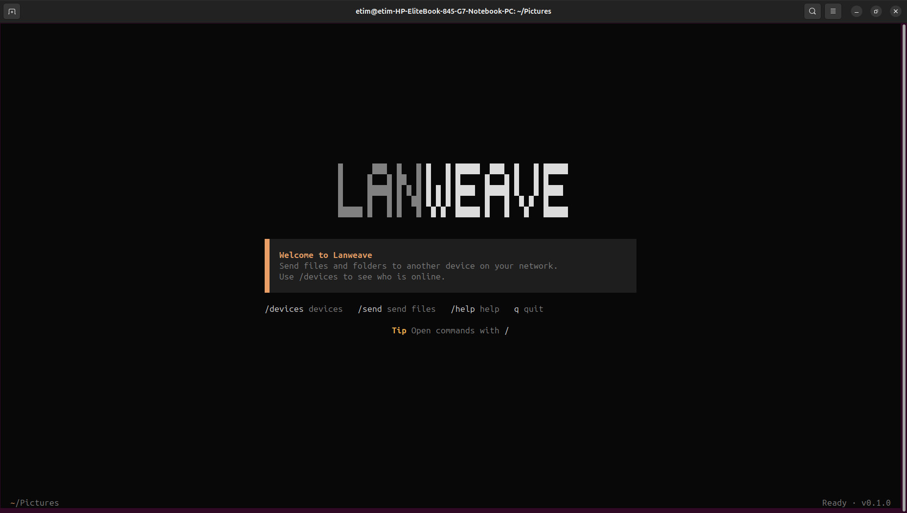
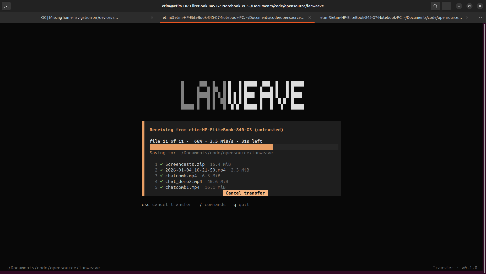

# Usage

<!-- SPDX-FileCopyrightText: 2026 Unyime Etim -->
<!-- SPDX-License-Identifier: Apache-2.0 -->

For install instructions, see the [README](../README.md#install).

Lanweave is interactive rather than a set of one-shot shell commands. Run `lanweave` to open the TUI; it starts on a quiet home screen that points at the available commands instead of opening the device list immediately. Press `q` outside the command palette, or Ctrl+C anywhere, to close it.

## Session Flow

1. Both users run `lanweave`. A device advertises and accepts requests only while Lanweave is running. A stale network record may remain visible briefly after an unclean exit, but the connection will fail and the record will expire.
2. User 1 opens the device list with `/devices`, selects User 2's device, and requests pairing.
3. User 2 sees the request and chooses **Accept** or **Reject**.
4. If User 2 accepts, their Lanweave app creates and displays a one-time eight-digit code. User 2 shares that code with User 1 to authorize the session.
5. User 1 enters the code. Lanweave checks the code and creates an authenticated, encrypted session between the two devices.
6. Either user can paste file or folder paths into the TUI, review them, and select **Send**. Folders are compressed into a single zip archive before the request is sent.
7. The other user sees a request with the names, sizes, count, and total size, including folder item counts, chooses the destination directory, and chooses **Accept** or **Reject** in the same dialog.
8. Accepted files are sent in order with live per-file progress. Each file is checked before it is saved under its final name.
9. Both users see a completion summary; the receiver also sees the directory the files were saved to.
10. After a transfer, either user can request another transfer in the same session, or cancel a pending or active one with the highlighted cancel button (or Escape, or `/cancel`).
11. Either user can close the session. Lanweave also closes it after 10 minutes with no transfer request or active transfer.

Closing the session removes its temporary authorization. The users must repeat the pairing and code flow before sending more files. Lanweave does not keep a trusted-device list.

## Commands

Enter `/` to open the command palette. Type to filter, use Up/Down to select, press Enter to run a command, Backspace to edit, and Escape to close it.

| Command | What it does |
| --- | --- |
| `/devices` | Opens the list of devices currently running Lanweave. Use Up/Down to select and Enter to connect. Each row shows the other computer's name, plus its network host name when names collide. Names are untrusted until pairing confirms the live connection. Escape (or `/home`) returns to the home screen. |
| `/connect` | Enters a `host:port` directly when discovery is unavailable. The address is validated before a connection can start. |
| `/send` | Opens the review list for files and folders. Paste one path per line (or a quoted path); `file://` URIs, Windows-style CRLF lists, and shell-escaped spaces are also accepted, and pasted paths are reviewed off the event loop so large folders do not block the screen. Press Enter to send, Backspace to remove the highlighted entry, and Escape to close. Pasting with no dialog open opens the review list directly. Available from the home screen, while browsing, or in an idle session, but files can only be sent from an authorized idle session. |
| `/cancel` | Cancels a pending or active transfer, including a folder that is still being compressed. A request cancelled before anything is sent returns to the session screen with a notice and keeps the reviewed files queued. |
| `/disconnect` | Closes the session. Available only while connected. |
| `/update` | Checks for a newer release. When one exists, the app shows its version and asks you to confirm before anything is downloaded; a finished update runs after you restart Lanweave. The startup check shows `/update to install vX.Y.Z` on the home screen when a newer release exists, and stays silent when it fails. |
| `/home` | Returns to the home screen. |
| `/help` | Shows command and keyboard help. |
| `/quit` | Closes Lanweave. |

## Keyboard And Dialogs

A few interactions work the same way across screens:

- A request that needs your decision appears as a highlighted dialog with buttons. Use Left/Right to move between **Accept** and **Reject** and press Enter to choose; Escape still rejects directly.
- When the peer accepts, they read the eight-digit code from their screen and you type it: digits to enter, Backspace to edit, Enter to submit, Escape to cancel. The code expires after about two minutes.
- `/cancel` (or Escape) cancels a pending or active transfer. Waiting screens show a single highlighted button, so Enter and Escape both cancel.

The exact command names may change during implementation, but `/` will always show the available actions.

## Screenshots

The home screen, with the welcome panel and the available commands:

Receiving a file transfer, with per-file progress and cancel option:

